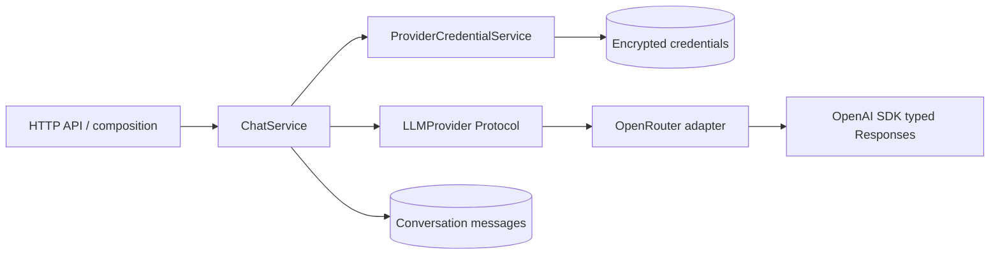

# AI Workspace

A BYOK multi-model chat app built with FastAPI, SQLAlchemy, PostgreSQL, and a
minimal React + TypeScript + Vite frontend. V1 supports OpenRouter with a user's
encrypted API key and non-streaming text chat.

## Local development

Requires Python 3.14+, uv and PostgreSQL. Install the locked dependencies with
`uv sync --locked`, then copy `.env.example` to `.env` and configure:

- `AI_WORKSPACE_DATABASE_URL`: a PostgreSQL URL using the `asyncpg` driver.
- `AI_WORKSPACE_JWT_SECRET_KEY`: a random secret of at least 32 characters.
- `AI_WORKSPACE_CREDENTIAL_ENCRYPTION_KEY`: a separate key generated with
  `cryptography.fernet.Fernet.generate_key()`. Keep it stable to decrypt saved keys.

Run `uv run alembic upgrade head`, then
`uv run uvicorn ai_workspace.main:app --reload`. Interactive API documentation is
available at `/docs`, and `/health` reports application health.

## 本地前端

前端需要 Node.js 22.12+（本次使用 Node.js 24）。在项目根目录启动后端：

```powershell
uv sync --locked
uv run alembic upgrade head
uv run uvicorn ai_workspace.main:app --host 127.0.0.1 --port 8000 --reload
```

另开终端启动前端：

```powershell
cd frontend
npm ci
npm run dev
```

打开 <http://127.0.0.1:5173>。Windows 若限制运行 `npm.ps1`，可使用 `npm.cmd`
代替 `npm`，无需修改 PowerShell 安全策略。

1. 注册账号，再使用同一邮箱和密码登录。
2. 在左侧保存 OpenRouter API Key；页面只显示是否已配置。
3. 新建会话，选择或输入完整模型 ID（例如已实测的 `openai/gpt-6-luna`）。
4. 输入消息并点击发送；等待完整回复后，刷新页面验证历史恢复。

模型输入框的下拉项仅是示例，不代表完整可用模型目录；也可直接输入其他
OpenRouter 模型 ID。现有后端没有模型列表接口，因此没有额外增加模型查询服务。
发送时只提交 `model` 和 `content`，沿用后端默认推理设置。

浏览器统一请求 `/api/...`；`frontend/vite.config.ts` 将请求转发到
`http://127.0.0.1:8000` 并移除 `/api` 前缀，无需新增 CORS 配置。
前后端都只监听本机回环地址。后端端口变化时修改 Vite 的代理目标。
构建与本地构建预览：

```powershell
cd frontend
npm run build
npm run preview
```

预览地址为 <http://127.0.0.1:4173>，也需要后端运行。开发服务器和 preview
均有本地代理；生产部署静态 `dist/` 时，需要部署方另行配置 `/api` 反向代理。
Vite 的配置依据：[代理文档](https://vite.dev/config/server-options#server-proxy)、
[环境变量文档](https://vite.dev/guide/env-and-mode)。

### 前端代码导读

前端只使用 React 自带的 `useState`、`useEffect`、`useRef` 等 Hooks，没有引入
路由器、状态管理库、UI 框架或 Markdown/HTML 渲染器。

| 文件 | 作用 |
| --- | --- |
| `frontend/src/types.ts` | 对应 FastAPI 响应字段，包括可空的 Token 用量。 |
| `frontend/src/api.ts` | 唯一 HTTP 入口，集中设置 Bearer 头、同源路径和安全错误文案。不会自动重试聊天请求；401/403 通知 App 清理登录状态。 |
| `frontend/src/App.tsx` | 恢复标签页 JWT 后先调用 `/users/me` 验证身份，再挂载工作区。退出或过期后卸载工作区，避免旧账号数据残留。 |
| `frontend/src/AuthForm.tsx` | 注册和登录表单；注册成功后转为登录，密码提交后从表单状态清除。 |
| `frontend/src/CredentialSettings.tsx` | 读取密钥配置状态、保存或删除密钥。保存提交后立即清空输入，只处理后端返回的元信息。 |
| `frontend/src/Workspace.tsx` | 会话列表、新建和选择会话、模型输入。当前会话和模型按用户 ID 保存在标签页中。 |
| `frontend/src/ChatPanel.tsx` | 读取服务端历史，非流式发送，然后重新读取已落库的消息。发送锁阻止同一页面重复提交，失败保留草稿。 |
| `frontend/src/session.ts` | 封装 `sessionStorage`；存储不可用时仍可在当前页面中使用内存登录。 |

刷新时的数据流：读取标签页 JWT → `/users/me` → 会话列表及密钥状态 → 恢复选中的
会话 → `/conversations/{id}/messages`。消息始终来自数据库，不缓存到浏览器存储。
切换会话时通过 `AbortController` 和组件 key 隔离请求，迟到响应不会覆盖新会话。
聊天成功而历史读取失败时，页面明确提示“刷新历史，无需重复发送”；网络异常时也提示
先查历史，避免盲目重复调用模型。

### API 对照与最小后端补充

以下均为后端路径，前端请求时添加 `/api` 前缀：

| 方法 / 路径 | 请求或响应 |
| --- | --- |
| `POST /users/register` | `{email, password}` → 用户信息，201。 |
| `POST /auth/login` | `{email, password}` → `{access_token, token_type}`。 |
| `GET /users/me` | 当前用户。 |
| `GET /providers/openrouter` | 密钥元信息，尚未配置时 404。 |
| `PUT /providers/openrouter` | `{api_key}` → 元信息，不返回明文或密文密钥。 |
| `DELETE /providers/openrouter` | 成功 204。 |
| `GET /conversations` | 当前用户的会话列表。 |
| `POST /conversations` | `{title}` → 新会话，201。 |
| `GET /conversations/{id}/messages` | **本次唯一新增接口**：`[{id, role, content, created_at}]`。 |
| `POST /conversations/{id}/chat` | `{model, content}` → `{content, model, usage}`。 |

新增消息接口先复用 `ConversationService.get()` 校验归属，再使用已有
`MessageRepository.list_by_conversation()` 按 `created_at ASC, id ASC` 读取消息。
其他用户和不存在的会话统一返回 404，未登录返回 401；响应设置 `private, no-store`。
没有修改数据表、迁移、聊天协议、鉴权协议或模型适配器。

### JWT 和 API Key

- JWT 保存在当前标签页的 `sessionStorage`，以支持刷新；不会写入 `localStorage`、
  URL、日志或构建配置。退出以及鉴权失效会清除本应用的标签页状态。
- 当前后端使用 Bearer JWT，没有 HttpOnly Cookie / refresh token 接口。
  `sessionStorage` 仍可被同源 JavaScript 读取，因此它不是 HttpOnly 级别的隔离。
  消息按 React 纯文本渲染，不执行模型返回的 HTML，也不加载第三方脚本。
- API Key 只经本地代理提交给后端，表单随后清空；不写入任何浏览器持久存储。
  后端沿用原有 Fernet 加密。不要把真实密钥放进 `VITE_*` 环境变量或源码。
- 前端工作目录独立，Vite 不加载项目根目录的后端 `.env`，开发文件服务也限制在
  `frontend/`。所有 API 请求关闭缓存、拒绝重定向；错误只展示固定安全文案。
- 本轮模型/用量只用于即时显示；原有消息表不保存模型与用量，刷新后不会伪造这些信息。

### 前端验证与真实聊天

```powershell
cd frontend
npm test
npm run build
```

`npm test` 使用模拟 HTTP 响应验证刷新恢复、登出清理、过期 JWT、跨会话请求竞态、
重复发送、失败草稿保留、HTML 纯文本渲染及 API Key 不持久化，不消耗模型额度。

另有**手动运行、会消耗模型额度**的真实联调脚本。先通过页面注册一个测试账号，
再将 `.env.example` 末尾列出的 `AI_WORKSPACE_TEST_*` 配置填入根目录 `.env`。
保持前后端运行，在项目根目录执行：

```powershell
uv run python scripts/smoke_chat.py
```

脚本经 Vite 代理登录现有测试账号，复用已配置的密钥（没有密钥时才保存 `.env` 中的
测试密钥），创建带“前端联调验证”标题的会话，完成两轮真实模型调用，检查上下文、
消息顺序和重新登录后的历史一致性。测试会话保留供页面查看，脚本只打印安全状态和
会话 ID。它不读取或修改其他会话，也不输出 JWT/API Key。

本次已实际验证浏览器注册 → 登录 → 配置 → 新建会话 → 真实聊天 → 页面刷新恢复，
以及脚本的两轮上下文验证。完整 PostgreSQL 自动化测试仍须使用下文所述的专用测试库。

## Backend API

Register through `POST /users/register`, sign in through `POST /auth/login`, and
use the returned Bearer token for authenticated requests. Save an OpenRouter key
with `PUT /providers/openrouter` using only an `api_key` field. Create a conversation
with `POST /conversations`, then send `model` and `content` to
`POST /conversations/{conversation_id}/chat`.

Include the optional `reasoning_effort` field to select reasoning effort for a turn:

```json
{
  "model": "openai/o4-mini",
  "content": "Explain why this algorithm works.",
  "reasoning_effort": "high"
}
```

Accepted values are `none`, `minimal`, `low`, `medium`, `high`, `xhigh` and `max`.
Omitting the field or sending `null` uses the model's default; the string `"none"`
requests no reasoning. The choice applies only to the current request and is not
saved as a conversation preference. Invalid values return 422. Supported levels
depend on the selected model; see OpenRouter's
[reasoning options](https://openrouter.ai/docs/guides/best-practices/reasoning-tokens).

## LLM boundary



`ChatService.complete_turn()` checks conversation ownership, looks up the user's
credential using the injected provider's `provider_id`, decrypts it for the call,
and supplies the message history to `generate()`. It persists the user and assistant
messages in one database transaction after generation succeeds. Repositories flush;
services own commits and rollbacks.

The protocol exposes only `provider_id` and asynchronous `generate()`. Inputs and
outputs are project-owned `ModelMessage`, `ModelResponse` and `TokenUsage` values.
SDK objects and exceptions stay inside the adapter. The only implemented
`ProviderId` is `openrouter`; fixed credential routes choose it server-side.
An OpenRouter model name such as `openai/...` does not select a different credential.

The HTTP Chat contract accepts `model`/`content` and optional `reasoning_effort`,
and returns `content`/`model`/`usage`.
Missing provider credentials return a safe 400; upstream failures return a safe 502.
The adapter rejects unusable text, invalid model values, embedded upstream errors
and responses reflecting the current key. It preserves valid text whitespace.

Usage is optional display information, not a billing ledger. Missing counts remain
unknown, without filling zeros or inferring totals. The adapter accepts SDK numeric
normalization, including values already coerced to integers. Malformed usage is
discarded as `null` without discarding a valid answer.

## Stateless Responses for V1

The OpenRouter adapter uses the official OpenAI Python SDK's typed
`responses.create()` method at `https://openrouter.ai/api/v1/responses`, with
`store=False` and `stream=False`. Every request supplies the complete PostgreSQL
message history and the new user message; no `previous_response_id` or provider
conversation is used. This follows OpenRouter's
[stateless contract](https://openrouter.ai/docs/api_reference/responses/overview)
and [OpenAI's Responses direction](https://developers.openai.com/api/docs/guides/migrate-to-responses).

When selected, `reasoning_effort` maps to the Responses API's `reasoning.effort`.
When omitted or null, the adapter omits `reasoning` from the upstream request.
See OpenRouter's [Responses reasoning configuration](https://openrouter.ai/docs/api_reference/responses/reasoning).

The adapter maps system/user messages to `input_text` items and assistant history
to `output_text` messages. OpenRouter
[requires assistant history to include id and status](https://openrouter.ai/docs/api_reference/responses/basic-usage),
so the adapter assigns IDs unique within each request and `status="completed"`.
These are local item identifiers, not persisted provider response IDs.

The SDK's `Response.output_text` aggregates output text in order, preserving
whitespace. Only completed responses without an error or incomplete details are
accepted; missing usable text is an error. `Response.model` maps to the project
model field, and `ResponseUsage.input_tokens`, `output_tokens` and `total_tokens`
map to `TokenUsage.prompt_tokens`, `completion_tokens` and `total_tokens`.
OpenRouter can omit usage detail objects that the SDK schema marks required; the
adapter uses the SDK's permissive typed parsing and validates only the project
contract, without re-parsing raw JSON or enforcing the entire OpenAI schema.

ChatService and the provider-neutral types do not depend on Responses. There is
no Chat Completions implementation or fallback. This mapping was checked against
the locked OpenAI SDK 3.22.1 and official documentation on 2026-10-03.

## Credentials and client lifecycle

- Keys are Fernet-encrypted at rest and scoped by the unique `(user_id, provider)`
  pair. Credential responses contain metadata only. Validation failures use a
  fixed response to avoid echoing submitted secrets.
- The OpenRouter endpoint is fixed by the adapter. Public credential requests no
  longer accept `base_url`, and responses no longer return it. The nullable database
  column remains legacy storage only; old values are ignored and new rows use null.
- Each generation owns and closes its SDK client. The explicit BYOK Authorization
  header overrides SDK ambient authorization, redirects are disabled, the SDK
  timeout is 60 seconds per operation, and SDK retries are disabled.
- The application limits `openai`, `httpx2`, `httpcore2` and existing child loggers
  to WARNING after SDK imports. Do not re-enable verbose SDK/transport logging or
  log raw upstream objects: they can contain sensitive headers and exception data.
  This is an application logging policy, not a general-purpose redaction system.

V1 does not implement streaming, retries/fallback, client caching, provider
registries, capability resolution, RAG or agents. It retains a read transaction
during generation and does not serialize concurrent turns on the same conversation.
Revisit transaction duration, cancellation and turn ordering when designing SSE.
A failed database commit cannot undo an already billed model request.

## Verification

Run `uv run ruff check src tests` and `uv run ruff format --check src tests`.

The full test suite needs a **dedicated test PostgreSQL database**, with
`AI_WORKSPACE_DATABASE_URL` pointing to it. Apply `uv run alembic upgrade head` to
that test database, then run `uv run pytest -q`. Integration tests use outer rollback
transactions and savepoints; do not use a production database for testing.

Provider tests run the real SDK over MockTransport with dummy keys and make no live
model calls. They cover typed mapping, error isolation, usage degradation, no
redirects/retries, concurrent BYOK isolation and cancellation cleanup. ChatService
tests use FakeProvider for business/transaction behavior and retain one real-adapter
wiring test. A separate process verifies application logging with `OPENAI_LOG=debug`
and a reflected key in the upstream request-ID header.

For checks without PostgreSQL, run:

```text
uv run pytest -q tests/test_openrouter_provider.py tests/test_provider_logging.py tests/test_chat_api.py tests/test_provider_credential_api.py tests/test_provider_credential_service.py tests/test_encryption.py
```

No live OpenRouter compatibility claim is made by these mocked tests. The opt-in
`scripts/smoke_chat.py` checks the configured model's Responses support, persisted
text, multi-turn context and history recovery with real requests. This was run
successfully with `openai/gpt-6-luna` on 2026-10-12, in addition to a real browser
chat and reload. Other models and upstream error shapes still need their own live
compatibility checks.
