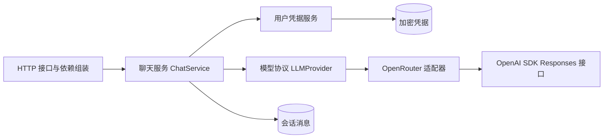

# AI Workspace

一个支持用户自带 API 密钥（BYOK）的多模型聊天应用，后端使用 FastAPI、SQLAlchemy 和
PostgreSQL，前端使用 React、TypeScript 和 Vite。首版通过 OpenRouter 调用模型，
加密保存每个用户的密钥，并提供非流式文本聊天。

## 线上使用与部署

- [打开 AI Workspace](https://ai-workspace-production-f76f.up.railway.app/)
- [部署、发布、费用控制与备份恢复说明](docs/deployment.md)

线上采用邀请码注册。注册后登录，在页面中保存自己的 OpenRouter 密钥，再创建会话并选择模型。
生产环境由同一个 HTTPS 服务提供首页、静态资源和 `/api/...` 接口。
本地开发使用下文的 Vite 代理和独立后端入口。

## 本地开发

需要 Python 3.14+、uv、PostgreSQL，以及 Node.js 22.12+（生产构建使用 Node.js 24）。
先安装锁定版本的依赖，将 `.env.example` 复制为 `.env`，再设置以下变量：

| 变量 | 用途 |
| --- | --- |
| `AI_WORKSPACE_DATABASE_URL` | PostgreSQL 连接地址，支持 `postgresql+asyncpg://`、`postgresql://` 和 `postgres://`，后端统一使用 asyncpg。 |
| `AI_WORKSPACE_JWT_SECRET_KEY` | 至少 32 字符的随机登录签名密钥。 |
| `AI_WORKSPACE_CREDENTIAL_ENCRYPTION_KEY` | 用 `cryptography.fernet.Fernet.generate_key()` 单独生成的加密主密钥；保留原值才能解密已保存的用户密钥。 |
| `AI_WORKSPACE_REGISTRATION_INVITE_CODE` | 生产环境必填的独立随机邀请码，至少 32 字符；本地开发可不设置。 |

在项目根目录启动后端：

```powershell
uv sync --locked
uv run alembic upgrade head
uv run uvicorn ai_workspace.main:app --host 127.0.0.1 --port 8000 --reload
```

本地接口文档位于 <http://127.0.0.1:8000/docs>，`/health` 返回应用健康状态。
生产环境关闭交互式接口文档，并使用 `/readyz` 检查数据库是否可用。

另开终端启动前端：

```powershell
cd frontend
npm ci
npm run dev
```

打开 <http://127.0.0.1:5173>。Windows 若限制运行 `npm.ps1`，可使用 `npm.cmd`
代替 `npm`，无需修改 PowerShell 安全策略。

1. 注册账号，再使用同一邮箱和密码登录；启用邀请注册时填写邀请码。
2. 在左侧保存 OpenRouter API 密钥；页面只显示是否已配置。
3. 新建会话，选择或输入完整模型 ID，例如已实测的 `openai/gpt-6-luna`。
4. 输入消息并点击发送，等待完整回复后刷新页面，确认历史消息仍然存在。

模型输入框的下拉项是示例，可直接输入其他 OpenRouter 模型 ID。
后端没有模型列表接口；是否可用取决于账号权限和模型。
页面发送时只提交 `model` 和 `content`，使用后端默认推理设置。

浏览器统一请求 `/api/...`；`frontend/vite.config.ts` 将本地请求转发到
`http://127.0.0.1:8000` 并移除 `/api` 前缀，因此无需额外配置 CORS。
本地前后端都只监听回环地址，后端端口变化时需同步修改 Vite 代理目标。

### 前端构建与预览

```powershell
cd frontend
npm run build
npm run preview
```

预览地址为 <http://127.0.0.1:4173>，预览时也需要后端运行。
开发服务器和构建预览均有本地代理；仓库的生产 Docker 镜像由后端直接提供 `dist/` 和 API。
如果单独托管静态 `dist/`，需自行配置 `/api` 反向代理。
配置参考：[Vite 代理文档](https://vite.dev/config/server-options#server-proxy)、
[Vite 环境变量文档](https://vite.dev/guide/env-and-mode)。

## 代码导读

| 目录或文件 | 作用 |
| --- | --- |
| `src/ai_workspace/api/` | HTTP 路由、鉴权依赖和安全错误响应。 |
| `src/ai_workspace/services/` | 注册、登录、凭据和聊天业务；负责事务提交与回滚。 |
| `src/ai_workspace/repositories/` | 数据库读写；执行 `flush`，由调用方决定事务何时提交。 |
| `src/ai_workspace/models/`、`schemas/` | 分别定义数据库模型和接口请求／响应结构。 |
| `src/ai_workspace/providers/` | 模型调用协议、通用数据类型和 OpenRouter 适配器。 |
| `src/ai_workspace/core/`、`db/` | 配置、密码、JWT、凭据加密和数据库连接。 |
| `src/ai_workspace/production.py` | 生产入口，组合首页、静态资源、API 和就绪检查。 |
| `alembic/` | 数据库迁移，使用与应用一致的连接配置。 |
| `scripts/` | 部署检查、手动真实聊天验证和加密备份工具。 |
| `tests/` | 后端单元测试和 PostgreSQL 集成测试。 |

### 前端组件

前端使用 React 自带的 `useState`、`useEffect`、`useRef` 等 Hooks，
没有额外引入路由器、状态管理库、UI 框架或 Markdown／HTML 渲染器。

| 文件 | 作用 |
| --- | --- |
| `frontend/src/types.ts` | 对应 FastAPI 响应字段，包括可空的 Token 用量。 |
| `frontend/src/api.ts` | 统一 HTTP 请求，设置 Bearer 头、同源路径和安全错误文案；聊天请求不自动重试，401/403 通知应用清理登录状态。 |
| `frontend/src/App.tsx` | 恢复标签页 JWT 后先调用 `/users/me` 验证身份；退出或过期时卸载工作区，清除旧账号数据。 |
| `frontend/src/AuthForm.tsx` | 注册与登录表单；注册成功后切换到登录，提交后清除密码和邀请码。 |
| `frontend/src/CredentialSettings.tsx` | 查看密钥配置状态、保存或删除密钥；提交后立即清空输入，只接收后端返回的元信息。 |
| `frontend/src/Workspace.tsx` | 会话列表、新建和选择会话、选择模型；当前会话和模型按用户 ID 保存在标签页中。 |
| `frontend/src/ChatPanel.tsx` | 读取服务端历史，非流式发送，再读取已落库消息；发送锁防止重复提交，失败时保留草稿。 |
| `frontend/src/session.ts` | 封装 `sessionStorage`；存储不可用时，仍可在当前页面中使用内存登录。 |

刷新时的数据流：读取标签页 JWT → `/users/me` → 会话列表及密钥状态 → 恢复选中的
会话 → `/conversations/{id}/messages`。消息来自数据库，不缓存到浏览器存储。
切换会话时通过 `AbortController` 和组件 `key` 隔离请求，迟到响应不会覆盖新会话。
聊天成功但历史读取失败时，页面会提示“刷新历史，无需重复发送”；
网络异常时也会提示先检查历史，避免重复产生模型调用费用。

## 后端接口

以下为后端入口的路径；生产环境和前端请求均添加 `/api` 前缀。
先注册和登录，再用返回的 Bearer 令牌访问需要登录的接口。

| 方法与路径 | 请求或响应 |
| --- | --- |
| `POST /users/register` | `{email, password, invite_code?}` → 用户信息，201；生产环境必须提供有效邀请码。 |
| `POST /auth/login` | `{email, password}` → `{access_token, token_type}`。 |
| `GET /users/me` | 当前用户。 |
| `GET /providers/openrouter` | 密钥元信息；未配置时返回 404。 |
| `PUT /providers/openrouter` | `{api_key}` → 元信息；不返回明文或密文密钥。 |
| `DELETE /providers/openrouter` | 成功时返回 204。 |
| `GET /conversations` | 当前用户的会话列表。 |
| `POST /conversations` | `{title}` → 新会话，201。 |
| `GET /conversations/{id}/messages` | `[{id, role, content, created_at}]`。 |
| `POST /conversations/{id}/chat` | `{model, content, reasoning_effort?}` → `{content, model, usage}`。 |

读取消息前，`ConversationService.get()` 会检查会话归属，再由
`MessageRepository.list_by_conversation()` 按 `created_at ASC, id ASC` 读取消息。
其他用户的会话和不存在的会话统一返回 404，未登录返回 401；响应禁止缓存。

聊天请求可用 `reasoning_effort` 指定本轮推理强度：

```json
{
  "model": "openai/o4-mini",
  "content": "请解释这个算法为什么有效。",
  "reasoning_effort": "high"
}
```

可选值为 `none`、`minimal`、`low`、`medium`、`high`、`xhigh` 和 `max`。
省略或传入 `null` 时使用模型默认值；字符串 `"none"` 表示请求关闭推理。
该设置只影响当前请求，不保存为会话偏好。无效值返回 422。
具体支持哪些档位取决于模型，参见 [OpenRouter 推理选项](https://openrouter.ai/docs/guides/best-practices/reasoning-tokens)。

## 模型调用与事务



`ChatService.complete_turn()` 先检查会话归属，根据注入适配器的 `provider_id`
查找并解密当前用户的密钥，再把历史消息交给 `generate()`。
模型生成成功后，在同一个数据库事务中保存用户和助手的两条消息。
仓储层只执行 `flush`，业务服务负责提交与回滚。

模型协议只暴露 `provider_id` 和异步 `generate()`。输入输出使用项目自己的
`ModelMessage`、`ModelResponse` 和 `TokenUsage`；SDK 对象和异常留在适配器内部。
当前 `ProviderId` 仅实现 `openrouter`，固定的凭据接口由服务端选择供应商。
模型名称中的 `openai/...` 不会切换到另一套供应商凭据。

缺少凭据时返回安全的 400，模型服务调用失败时返回安全的 502。
适配器拒绝不可用文本、无效模型值、响应中嵌入的上游错误，以及回显当前密钥的响应，
并保留有效文本中的空白字符。

Token 用量用于页面展示，不作为计费账本。缺失的数值保持未知，不补零、不推算总数。
适配器接受 SDK 已完成的数值规范化；用量格式有误时返回 `null`，仍保留有效回答。

### 首版的无状态 Responses 调用

OpenRouter 适配器使用官方 OpenAI Python SDK 的 `responses.create()`，请求地址为
`https://openrouter.ai/api/v1/responses`，固定 `store=False`、`stream=False`。
每次请求都提交 PostgreSQL 中的完整历史和本轮用户消息，不使用 `previous_response_id`
或供应商侧会话。参考 [OpenRouter 无状态约定](https://openrouter.ai/docs/api_reference/responses/overview)
和 [OpenAI Responses 迁移说明](https://developers.openai.com/api/docs/guides/migrate-to-responses)。

指定 `reasoning_effort` 时，将其映射到 `reasoning.effort`；省略或传入 `null` 时，
上游请求不包含 `reasoning`。参考 [Responses 推理配置](https://openrouter.ai/docs/api_reference/responses/reasoning)。

系统和用户消息映射为 `input_text`，助手历史映射为 `output_text`。
[OpenRouter 要求助手历史包含 id 和 status](https://openrouter.ai/docs/api_reference/responses/basic-usage)，
因此适配器为每个请求分配内部唯一 ID，并设置 `status="completed"`。
这些 ID 只标记当前请求中的消息，不作为供应商响应 ID 持久化。

SDK 的 `Response.output_text` 按顺序汇总文本并保留空白。
应用只接受已完成、没有错误或未完成信息、且包含有效文本的响应。
`Response.model` 映射为项目的模型字段；`ResponseUsage.input_tokens`、`output_tokens`、
`total_tokens` 分别映射为 `TokenUsage.prompt_tokens`、`completion_tokens`、`total_tokens`。
OpenRouter 可能省略 SDK 标记为必填的用量明细，适配器因此使用 SDK 的宽松解析，
只校验项目需要的字段，不重新解析原始 JSON 或强制校验整个 OpenAI 响应结构。

`ChatService` 和通用模型类型不依赖 Responses 协议。
当前没有 Chat Completions 实现或自动回退。该映射于 2026-10-03
对照锁定的 OpenAI SDK 3.22.1 和官方文档完成核验。

## 登录、密钥与安全边界

- JWT 保存在当前标签页的 `sessionStorage` 中以支持刷新，不写入 `localStorage`、URL、
  日志或构建配置。退出和鉴权失效时会清除本应用的标签页状态。
- 当前使用 Bearer JWT，没有 HttpOnly Cookie 或刷新令牌接口。同源 JavaScript 可以读取
  `sessionStorage`。聊天消息以 React 纯文本展示，不执行返回的 HTML，也不加载第三方脚本。
- API 密钥通过同源接口提交给后端，表单随后清空，不写入浏览器存储。
  后端使用 Fernet 加密，并以 `(user_id, provider)` 唯一约束隔离用户凭据。
  响应只包含元信息；校验错误使用固定文案，避免回显输入的密钥、密码或邀请码。
- OpenRouter 地址由适配器固定。凭据接口不接受或返回 `base_url`；数据库中的可空列
  仅为历史兼容而保留，旧值不会使用，新记录写入 `null`。
- 每次生成独立创建并关闭 SDK 客户端。显式 BYOK Authorization 头优先于 SDK 环境配置；
  禁止重定向，单次操作超时为 60 秒，SDK 自动重试关闭。
- SDK 导入后，应用会将 `openai`、`httpx2`、`httpcore2` 及现有子日志器限制为 WARNING。
  请勿开启详细 SDK／传输日志或记录上游原始对象，以免暴露请求头和异常中的凭据。
- Vite 不加载根目录的后端 `.env`，开发文件服务限制在 `frontend/`。
  不要将真实密钥写入 `VITE_*` 变量或源码。所有 API 请求关闭缓存、拒绝重定向，
  页面只显示预设的安全错误文案。
- 消息表暂不保存模型和 Token 用量，页面仅即时展示本轮信息，刷新后不会补造这些数据。

首版暂不包含流式回复、重试与备用模型、客户端缓存、供应商注册表、能力解析、RAG 或智能体。
生成期间会保持读取事务，也未对同一会话的并发请求进行串行化；后续设计 SSE 时需同时考虑
事务时长、取消和消息顺序。数据库提交失败无法撤销已经计费的模型调用。

## 验证与测试

运行静态检查和前端测试：

```powershell
uv run ruff check src tests scripts
uv run ruff format --check src tests scripts
cd frontend
npm test
npm run build
```

完整后端测试必须使用**专用 PostgreSQL 测试库**。将 `AI_WORKSPACE_DATABASE_URL`
指向测试库，执行 `uv run alembic upgrade head` 后，再运行：

```powershell
uv sync --locked --group backup
uv run pytest -q
```

集成测试使用外层回滚事务和保存点。请勿把生产库用于测试。
GitHub Actions 使用独立 PostgreSQL 18，同时检查前端、生产镜像以及加密备份镜像的导出与恢复。
首次上线时已通过 244 项后端测试和 9 项前端测试，部署记录见[上线验收说明](docs/deployment.md#上线验收)。

供应商测试使用真实 SDK 配合 `MockTransport` 和虚拟密钥，不发起真实模型请求。
覆盖响应映射、错误隔离、用量缺失、禁止重定向与重试、并发密钥隔离和取消清理。
聊天服务测试使用 `FakeProvider` 验证业务和事务，另保留真实适配器的组装测试。
独立进程还会验证 `OPENAI_LOG=debug` 及上游请求 ID 回显密钥时的日志隔离。

无需 PostgreSQL 的部分测试可单独运行：

```text
uv run pytest -q tests/test_openrouter_provider.py tests/test_provider_logging.py tests/test_chat_api.py tests/test_provider_credential_api.py tests/test_provider_credential_service.py tests/test_encryption.py
```

### 手动真实聊天验证

`scripts/smoke_chat.py` 会产生**两次计费模型调用**。先通过页面注册测试账号，
再将 `.env.example` 末尾的 `AI_WORKSPACE_TEST_*` 填入本地 `.env`。
保持前后端运行，在项目根目录执行：

```powershell
uv run python scripts/smoke_chat.py
```

脚本登录现有测试账号，优先复用已配置密钥，仅在没有密钥时保存指定的测试密钥。
它创建带“前端联调验证”标题的会话，检查两轮上下文、消息顺序和重新登录后的历史一致性。
测试会话会保留供页面查看；脚本只打印安全状态和会话 ID，不输出 JWT 或 API 密钥。
远程生产验证必须使用独立配置文件和 HTTPS，操作方法见[部署说明](docs/deployment.md)。

模拟测试不能替代真实模型兼容性验证。`openai/gpt-6-luna` 已于 2026-10-12 完成本地真实联调，
并于 2026-10-14 完成线上两轮聊天及刷新、重新登录、重新部署后的历史保留验证。
其他模型和上游错误形式仍需单独核验。

## 文档与注释约定

README、操作文档、代码注释和函数说明以中文为主，重点解释用途、设计原因和注意事项。
变量名、函数名、文件名、接口路径、环境变量、数据库字段和机器使用的状态值保留英文。
固定接口错误文本保持兼容，由前端统一映射为中文提示；结构化日志中的状态键和值也保留原样。
产品名称和模型 ID 保持原名，便于查阅官方资料。
