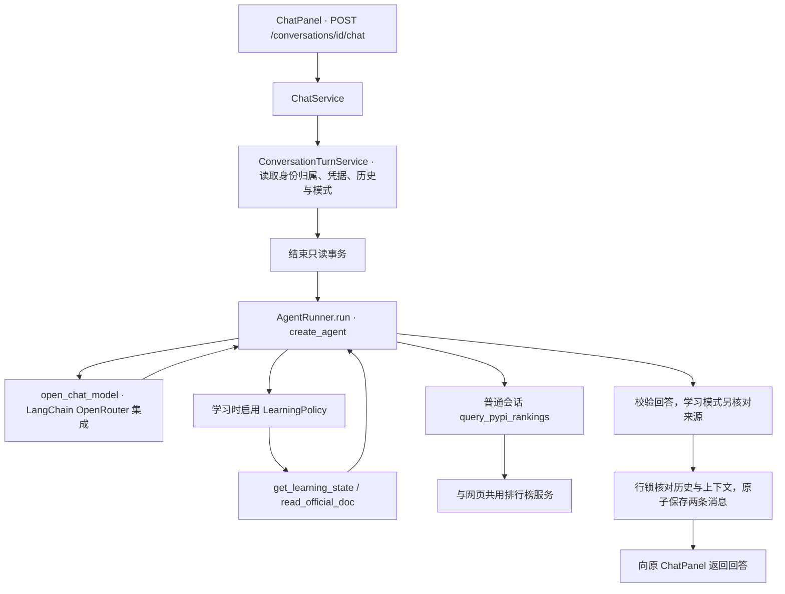

# 统一 Agent 运行链路

AI Workspace 的普通聊天和学习模式共用一个执行器与模型工厂。模式决定提示词、可用工具、
回答校验和预算；同一套基础代码负责模型调用、事务与历史。学习地图是工作台的一个入口，
不会创建第二套聊天界面或消息历史。

## 一条消息经过什么

1. `services/chat.py` 根据数据库中保存的会话上下文准备本轮请求。调用者不能在发送消息时
   随意更换账号、Notion 页面或已经绑定的学习来源。
2. `services/turn.py` 的 `ConversationTurnService` 检查会话归属，读取并解密当前用户的
   OpenRouter 密钥，复制历史和上下文，然后结束读取事务。
3. `agents/runner.py` 的 `AgentRunner.run()` 在一次请求中创建并运行 `create_agent`。
   `source=None` 表示普通模式；`source="demo"` 或 `"notion"` 表示 FastAPI 学习模式。
   这里的 `source` 由服务端上下文决定，不是模型可修改的工具参数。
4. `providers/openrouter.py` 的 `open_chat_model()` 创建 LangChain OpenRouter 集成
   `ChatOpenRouter`，调用 Chat Completions，并在退出时关闭客户端。
5. 回答通过校验后，共享会话服务重新锁定会话，检查生成期间历史和上下文是否改变，
   将用户问题与助手回答一起提交。冲突返回 409，不追加基于旧历史的答案。

模型和工具等待期间不占用读取事务。生成已经计费但保存失败时，数据库回滚不能撤销模型费用，
应先刷新历史再决定是否重发。旧学习 HTTP 路径只是兼容入口，也进入这条链路。

## 模式与工具的区别

| 项目 | 普通模式 | FastAPI 学习模式 |
| --- | --- | --- |
| 执行器 | `AgentRunner` / `create_agent` | 同左 |
| 业务工具 | 公共 PyPI 月度榜单查询 | 学习记录、三章官方文档的只读工具 |
| 场景策略 | 通用问答与公共数据分析 | `learning/policy.py` 的 `LearningPolicy` |
| 回答要求 | 有效文本；使用榜单后附实际来源摘要 | 结构化答案、实际来源核验、demo 明确标记 |
| 模型请求时限 | 每次 60 秒，整轮 Agent 最多 120 秒 | 每次 45 秒，整轮 Agent 最多 120 秒 |
| 应用设置的输出上限 | 不套用学习模式的 2,000 Token 上限 | 每次模型调用 2,000 输出 Token |
| 调用预算 | 最多三次模型调用、两次排行榜工具调用 | 最多五次模型调用、六次资料工具调用 |
| 推理设置 | 可传 `reasoning_effort` | 仅省略或 `null`，使用模型默认值 |

普通模式通过 `create_agent` 执行，可调用 `query_pypi_rankings` 查询公共榜单。服务由
依赖注入提供，工具首次读取完整目录后固定本轮快照；后续筛选使用与网页相同的纯函数。
工具查询失败时不保存模型自行猜测的排行榜数字。没有调用工具的通用回答不会附上虚构来源。
这些措施不等于逐条核验模型的分析；来源摘要只证明使用过哪些数据。

提到 FastAPI、Notion 或某项技术不会自动改变模式或获得私人资料权限。学习策略负责权限、
提示词、工具会话与来源核验，不再独立维护另一套模型客户端或 Agent 运行循环。
只在独立测试等场景未注入排行榜服务时，执行器仍支持无工具、一次模型调用的普通文本模式。

两个学习工具仍调用 `LearningService`。模型只能选择允许的章节，不能指定任意 URL、用户 ID
或页面 ID。学习资料属于参考数据，不能作为改变权限的指令。读取结果按本轮缓存；官方正文
最多提供 18,000 字符，笔记最多 8,000 字符，截断与不完整状态明确返回。引用核验只能证明
来源实际读到过，不能自动证明每句讲解正确。

## 历史、资源与边界

PostgreSQL 中的会话与消息是唯一持久历史。普通模式传入会话文本历史；学习模式使用近期完整
消息，最多 20 条、24,000 字符，包含本轮问题。每次请求重建 Agent 状态，不新增 checkpoint、
供应商侧会话或进程内长期记忆。

用户问题与最终回答保存到消息表，学习回答附上的来源文字也会保存。结构化 `sources`、
`tool_calls` 和 Token 用量仍只随本轮响应返回，没有新增运行轨迹表。两个模式都使用非流式回复。

模型地址固定为 OpenRouter，显式使用当前用户凭据，关闭自动重试、重定向、模型缓存与外部
LangSmith 追踪。模型工厂与执行器将预期的失败转换为安全错误，并检查已知凭据回显。
Notion 和官方文档读取继续使用 `httpx2`；公共排行榜使用无凭据的独立 `httpx` 客户端，
模型集成的客户端也独立管理。共用运行链路不意味着不同外部服务共用 Authorization 请求头。

## 验证

2026-11-01，排行榜接入前的统一重构：后端全量 **542 项测试通过**，Ruff 检查、格式检查与差异检查通过。
测试覆盖同一执行器下的普通文本和学习工具循环、实际模型名、部分用量、推理设置、
权限隔离、调用限制、超时取消与数据库并发冲突；SDK 测试使用模拟传输。

另外使用本地配置的 `openai/gpt-6-luna` 完成真实联调：

- 普通聊天两轮，第二轮正确回忆第一轮标记；四条消息保存，重新登录后历史一致。
- Notion 学习一轮，地图读取 26 条记录，FastAPI 笔记完整；两个资料工具成功，
  引用通过核验，两条消息和会话学习上下文保存成功。

测试会话留在本地供检查；未修改 Notion 学习记录。本次重构没有新增数据库迁移。
