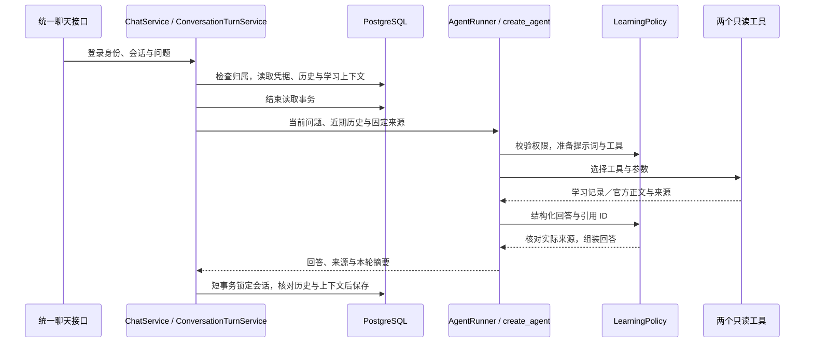

# 只读学习模式

2026-10-31：已接入 LangChain `create_agent`，复用第一阶段的两个资料读取器。
后端可以读取学习进度、选择官方测试章节、讲解并给出来源，支持从数据库历史继续追问。
2026-11-01 已完成真实 Notion 只读接入；其他环境仍需按
[连接说明](learning-sources.md#配置自己的-notion-连接) 配置。

现在可从 [学习地图](learning-map.md) 的 FastAPI 卡片进入现有聊天界面。
普通与学习会话统一使用 `/conversations/{id}/chat`，根据数据库保存的主题与来源选择执行方式。
两者也共用 `AgentRunner`、`create_agent` 和 LangChain OpenRouter 模型工厂；学习模块只提供
场景策略与资料工具。普通会话不会因提到技术名称就自动获得学习工具。结构化运行记录持久化
和 Notion 写回仍待实现。整体链路见 [统一 Agent 运行链路](agent-runtime.md)。

## 先体验一次

安装锁定依赖，按项目 README 配好本地数据库，启动后端：

```powershell
uv sync --locked
uv run alembic upgrade head
uv run uvicorn ai_workspace.main:app --host 127.0.0.1 --port 8000 --reload
```

使用已有测试账号，并确认这个账号已在应用中保存 OpenRouter 密钥。本地 `.env` 中需要已有的
`AI_WORKSPACE_TEST_EMAIL`、`AI_WORKSPACE_TEST_PASSWORD` 和 `AI_WORKSPACE_TEST_MODEL`。
测试脚本不会自动替换用户凭据，也不打印 JWT 或密钥。

```powershell
uv run python scripts/smoke_learning_agent.py
```

它会检查地图列表与详情，创建一个“学习地图联调”会话，通过统一聊天接口完成两轮真实模型请求，
访问真实 FastAPI 官网，检查工具调用、引用、持久化学习上下文和数据库中的四条消息。
默认使用虚构的 demo 进度；`--source notion` 使用真实学习记录，并只打印回答字符数。
每轮最多五次模型调用，会产生模型费用；测试会话保留在本地应用中。
仅检查一轮可加 `--turns 1`。脚本仅接受本地后端地址，不带 `/api` 前缀。

统一后的真实 Notion 学习联调已通过，日期与范围见文末验证记录。
其他模型需要单独验证工具调用兼容性；两千输出 tokens 的上限也包括模型可能使用的推理预算。

## HTTP 接口

新界面在创建会话时传 `learning_topic: "fastapi"` 与 `learning_source: "demo" | "notion"`，
随后向 `/conversations/{conversation_id}/chat` 提交普通的 `model` 和 `content`。
下列旧接口仅保留 HTTP 兼容入口，仍进入同一个 `ChatService` 和 `AgentRunner`，
首次成功时为未绑定会话保存学习上下文：

```text
POST /learning/fastapi/conversations/{conversation_id}/chat
Authorization: Bearer <本地登录令牌>
```

请求示例：

```json
{
  "model": "openai/gpt-6-luna",
  "content": "根据我的进度，讲解 AsyncClient 和 ASGITransport，并给一道小练习。",
  "source": "demo"
}
```

配置 Notion 后，创建会话时选择 `"learning_source": "notion"`；兼容接口对应字段为
`"source": "notion"`。已有学习会话不能切换来源。学习模式仍使用模型默认推理设置，
`reasoning_effort` 只允许省略或 `null`。
未配置或连接不属于当前用户时，在模型调用前失败。
接口不接受用户 ID、页面 ID、API 密钥或任意文档 URL。前端代理／生产入口需要在路径前加 `/api`。

响应中的主要字段：

| 字段 | 含义 |
| --- | --- |
| `content` | 回答正文，服务端附上来源链接；演示模式有固定提示 |
| `status` | `answered` 或 `needs_clarification`；后者也用于说明资料不足或读取失败 |
| `source` | 明确区分 `demo` 与 `notion` |
| `sources` | 本轮已实际取得且被回答引用的来源、读取时间、内容哈希和截断标记 |
| `tool_calls` | 工具名称、章节、成功／失败、受控错误码、是否命中本轮缓存 |
| `usage` | 本轮模型调用的 Token 合计；任意调用缺失的计数保持未知 |

只有实际取得的来源 ID 能通过校验；实质讲解还必须成功读取学习状态并引用至少一个官方章节。
这验证的是来源可追溯性，不能自动证明回答中的每一句解释都正确，仍需结合评测与使用反馈检查。
历史中保存用户问题和带来源的回答；`tool_calls`、结构化 `sources` 和用量目前仅随本轮响应返回。

## 一轮请求如何运行



普通聊天和学习对话共用执行器、模型工厂及会话与消息表。每次运行都重新创建 Agent 与客户端，
学习模式额外创建工具上下文，
不会在不同账号之间复用模型凭据或读取缓存。对话记忆来自数据库传入的历史，未使用进程内
`MemorySaver` 冒充持久化，也没有开启外部 LangSmith 跟踪。

历史上下文最多 20 条、24,000 字符，包含本轮问题；保留完整消息并从较早内容开始裁剪。
学习模式每次模型请求最多 45 秒、整轮 Agent 运行最多 120 秒，每次最多 2,000 输出 Token；
工具最多调用六次，模型最多调用五次。官方正文最多向模型提供
18,000 字符，笔记最多 8,000 字符，超出时明确标记。缓存只持续本轮请求。

同一学习会话生成期间若历史发生变化，保存时返回 409，避免追加基于旧历史的回答。
这时模型调用可能已经计费，应先刷新历史再决定是否重新发送。
普通聊天与兼容学习接口也使用相同的快照与行锁检查，不能从另一入口绕过这一保护。

## 结合项目学习代码

1. `src/ai_workspace/learning/tools.py`：看 `build_tools()`。`@tool` 提供说明和参数结构，
   实际读取仍调用 `LearningService`；身份和来源绑定在后端，不让模型传入。
2. `src/ai_workspace/agents/runner.py`：看共享的 `create_agent()` 与 `ainvoke()`。
   普通模式可查询公共 PyPI 榜单；学习模式可读取学习记录和官方章节。模型提出工具调用，
   框架执行 Python 函数，将结果作为 `ToolMessage` 再交给模型。middleware 限制调用次数并拦截已知凭据。
3. `src/ai_workspace/learning/policy.py`：看学习权限、提示词、工具会话和来源核验。
   学习模式用 `LearningAnswer` 约束最终输出，策略再核对引用并组装带来源的回答。
4. `src/ai_workspace/services/turn.py`：看共享的数据库读取、外部调用和保存之间的事务边界。
   `services/chat.py` 根据会话上下文调用同一个执行器；HTTP 兼容入口不另建持久化流程。
5. `src/ai_workspace/providers/openrouter.py`：看 `open_chat_model()` 如何按模式设置限制，
   并管理当前用户凭据与客户端生命周期。

先能说明这条调用链，再按需要深入各个校验分支。

## 模型接入与依赖

普通与学习模式均使用 LangChain OpenRouter 集成的 `ChatOpenRouter`，经共享
`open_chat_model()` 调用 Chat Completions，并使用应用中当前用户的 OpenRouter 凭据。
原普通聊天的 OpenAI Responses 适配器与学习专用模型工厂已经合并。
读取网页用既有 `httpx2`，OpenRouter SDK 使用 `httpx`；两套客户端均有独立的资源管理。

已锁定 LangChain 1.4.7、langchain-core 1.7.3、langchain-openrouter 0.2.9。
OpenRouter SDK 当前要求 Pydantic `<2.13`，依赖解析选用了 2.12.5。
Python 3.14 导入 LangChain 的旧 Pydantic v1 兼容层时可能出现警告；本项目模型使用 Pydantic v2，
当前版本已通过实际工具循环与全量后端测试。

模型客户端固定地址，关闭自动重试、重定向和缓存，按请求关闭资源。
`ChatOpenRouter(max_retries=0)` 单独不足以关闭底层默认重试，因此工厂显式设置 SDK `retry_config=None`。

## 验证

2026-11-01 统一运行链路后：后端全量 **542 项通过**，Ruff 检查与格式检查通过。
测试覆盖实际框架工具循环、来源校验、用户隔离、调用次数、超时与取消、日志／凭据保护，
以及 PostgreSQL 事务与冲突处理。模型 HTTP 协议测试使用模拟传输，不产生模型费用。

```powershell
uv sync --locked --group backup
uv run pytest -q
uv run ruff check src tests scripts
uv run ruff format --check src tests scripts
```

2026-11-01 通过共享链路完成普通聊天两轮和真实 Notion 学习一轮；学习记录、官方文档
工具与引用核验成功，对话和学习上下文已保存。详见 [统一链路验证](agent-runtime.md#验证)。

实现时核对的官方资料：

- [LangChain Agents](https://docs.langchain.com/oss/python/langchain/agents)
- [create_agent API](https://reference.langchain.com/python/langchain/agents/factory/create_agent)
- [ChatOpenRouter](https://docs.langchain.com/oss/python/integrations/chat/openrouter)
- [ModelCallLimitMiddleware](https://reference.langchain.com/python/langchain/agents/middleware/model_call_limit/ModelCallLimitMiddleware)
