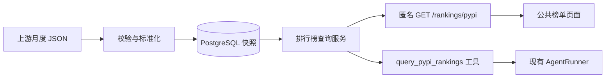

# PyPI 月度下载榜

这是 AI Workspace 的首个公共数据页面。无需登录即可浏览精选 Python 包的月度下载量，
搜索包名、按类别筛选，并选择包进入现有助手。登录、配置个人模型密钥后，只有点击发送
才会调用模型；浏览榜单不会调用大模型，也不会读取 Notion 或个人对话。

## 数据是什么

- 来源：[hugovk/top-pypi-packages](https://github.com/hugovk/top-pypi-packages)。
- 上游生成脚本从 ClickHouse 查询上一个完整自然月，目标覆盖下载量最高的 15,000 个包。
- 本项目维护一个版本化的精选目录，第一版 20 个包。排名只在这份目录中计算，不是全 PyPI 排名。
- 分类是项目维护的导航信息，不是 PyPI 官方分类。`redis` 表示 Python 客户端，不能代表 Redis 数据库的使用量。
- 下载次数不代表独立用户数、质量、招聘需求或学习优先级。跨类别排名用于浏览，同类技术才能围绕具体任务比较。

数据的统计月份、上游更新时间和本项目抓取时间分别保存、展示。例如，2026-10-01 生成的
快照按当前上游脚本对应 2026-09 的统计，不能标成“10 月下载量”。上游文件目前没有独立
的统计月份字段；本项目按已经核对过的月度生成规则推导，并在来源说明中保留这个依据。

没有出现在上游 Top N 快照中的目录包，显示“本期未收录”，下载量与排名保持 `null`。
不会补零，也不根据缺失值计算增长。第一版没有历史曲线或增长率；单期数据不足以判断趋势。

## 一份服务，两个入口



普通程序完成匹配、排序和筛选。Agent 只调用服务取得结果，再根据用户目标解释。
排名相同的下载量用包名稳定排序；分类和搜索后仍保留精选目录中的名次。

模型不能指定抓取 URL、数据库查询或用户身份。普通聊天接入一个公共排行榜工具；
FastAPI 学习会话仍使用原有学习工具与来源校验。页面中的“让助手比较”进入普通会话，
不会改变已经绑定 Notion 学习来源的会话。

同一轮工具查询固定一份快照。成功使用数据后，回答会附上实际查询的来源摘要，随现有
聊天历史保存。这能追溯使用过的数据，不等于自动验证了模型回答中的每一句分析。

## 缓存与更新

PostgreSQL 保留经过校验的原始快照和内容哈希；目录单独版本化。再次读取相同数据不
重复创建快照。发生上游修订时可以保留不同版本，后续趋势功能可据此核对统计口径。

常规浏览复用 24 小时缓存，到期时检查上游；服务用数据库中的 60 秒刷新租约协调多个进程。
下载期间不持有数据库事务。刷新失败时保留最近一次成功数据，并明确标记状态；
尚无任何快照时返回可重试的不可用状态；冷启动时其他进程正在刷新也返回可重试状态。
失败后退避 10 分钟，连续刷新网页不会持续访问上游。

第一版采用“访问时检查 + 手动刷新命令”，没有新增后台队列或独立调度服务。需要固定
时间更新时，可由部署平台的定时任务调用同一个刷新命令，不必再实现一套数据计算逻辑。

## 本地运行

使用已有 PostgreSQL 配置，不需要新的 API 密钥。在项目根目录执行：

```powershell
uv run alembic upgrade head
uv run python scripts/refresh_pypi_rankings.py
```

启动现有后端与 Vite 后，打开 `http://127.0.0.1:5173`。未登录也能浏览榜单。
API 的后端路径为 `GET /rankings/pypi`，浏览器与生产入口使用 `/api/rankings/pypi`。

支持 `query`、`category`、重复的 `projects` 参数和 `limit`。筛选只影响结果集，不改变
原始快照。公共接口不提供强制刷新参数，避免访客绕过缓存触发上游请求。

## 验证要点

默认匿名只读检查：

```powershell
uv run python scripts/smoke_pypi_rankings.py
```

显式加 `--with-agent` 会使用 `.env` 中已有的本地测试账号和模型，创建测试会话并产生
真实模型调用费用；检查数字、月份、来源和消息持久化，不输出密钥。远程测试必须使用
HTTPS，并通过 `--env-file` 指定独立测试配置。

1. 匿名访问榜单成功，而个人学习记录和对话仍要求登录。
2. 同一快照在页面和 Agent 工具中得到一致的排序、筛选和下载量。
3. 未收录、上游失败、旧月份、无数据和空搜索结果分别有准确状态。
4. 重复请求使用缓存；失败刷新不会清空已保存的快照。
5. 从榜单登录后继续比较，只预填问题，不自动发送或读取私人资料。

2026-11-01 本地验证：后端全量 **603 项**、前端 **32 项**测试通过，Ruff、TypeScript
与 Vite 构建通过。用生产 ASGI 入口验证静态资源、匿名榜单与私人接口鉴权通过。
浏览器验证匿名筛选、登录后预填、切页保留草稿和退出清理；390px 宽度的页面与表格无横向溢出。

真实上游首次导入覆盖 15,000 个包，20 个候选全部匹配；读到的快照为 2026-09，源文件
更新于 2026-10-01，正确显示较旧月份提示。使用本地已配置模型完成一轮真实 Agent 查询，
FastAPI 与 Flask 的原始下载量、统计月份和快照标识与公共接口一致，回答随会话保存。

生产镜像包含刷新脚本，可执行 `python /app/scripts/refresh_pypi_rankings.py`。
本轮没有配置外部定时任务或部署线上版本。

上游依据：[生成脚本](https://github.com/hugovk/top-pypi-packages/blob/main/clickhouse.py)、
[更新工作流](https://github.com/hugovk/top-pypi-packages/blob/main/.github/workflows/update.yml)。
下载统计的限制见 [Python Packaging 指南](https://packaging.python.org/en/latest/guides/analyzing-pypi-package-downloads/)。
